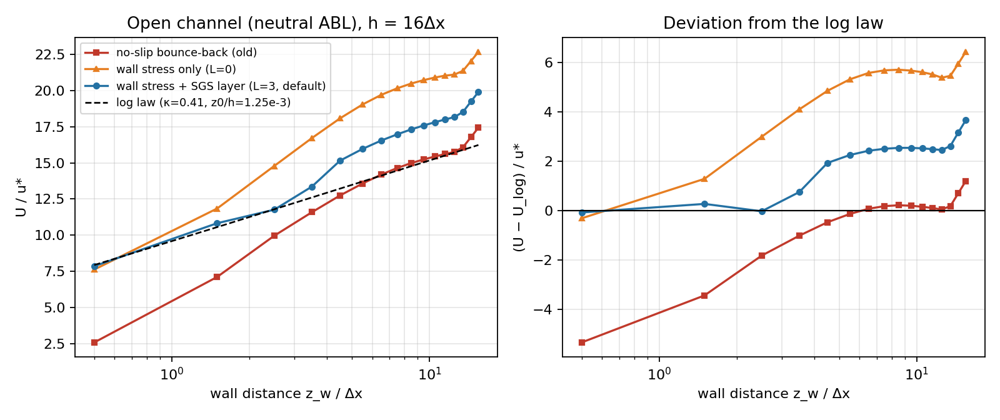
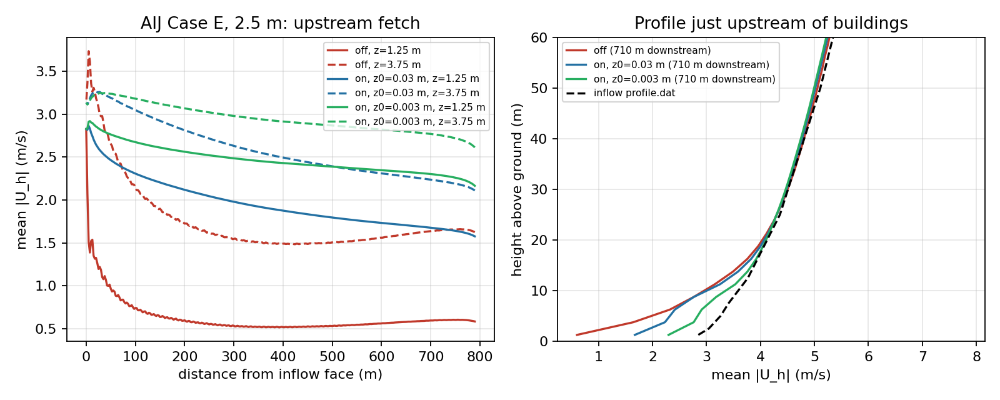
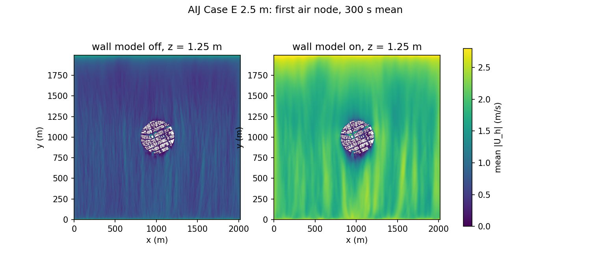
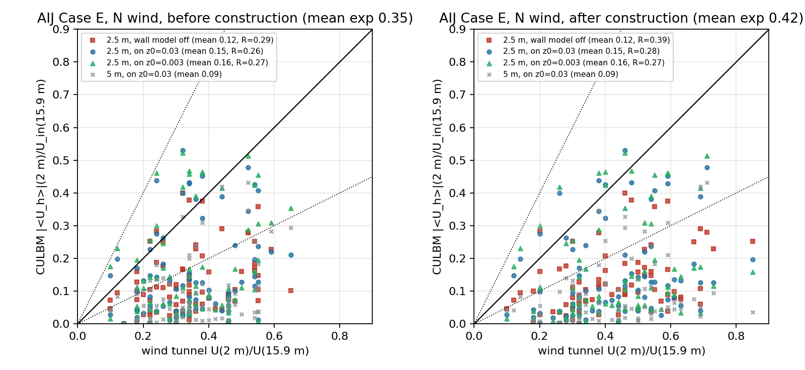

# CULBM 反弹壁面模型：实现与验证（2026-11-18）

版本：`CULBM-v3.5-261118-wall-model`。材料与脚本：`core/cfd_core/CULBM/test-output/wall-model-20261118/`
（大体积 VTK 已删除，可按各算例目录内 deck 重算）；图：`output/reports/CULBM_wall_model_20261118/`。

## 1 结论

- **可行，且已实现。** 在 link-wise 反弹（TYPE_S 体素壁）上加入对数律壁面应力模型，deck 默认开启
  （`culbm_wall_model=true`），可关闭恢复原无滑移。SurfaceIBM 工况下作用于压实地基首层；IBM 表面的
  切向应力模型尚未实现（第 6 节给出设计）。
- **近壁解析显著改善。** 中性开放槽道（h=16Δ）首个空气节点 U/u* 偏差：无模型 −5.3（约 −67%），
  壁面模型 −0.1；AIJ Case E 2.5 m 网格上游 400 m 处 1.25 m 高平均风速 0.52→2.43 m/s（来流 2.85，
  z0=0.003 m）；建筑区首层平均风速 0.60→2.02 m/s。
- **开销很小。** 壁面模型只改动近壁格点读入的反弹分布；非近壁格点只多做 6 次 flag 读取。寄存器 80→84，
  FP16C 单卡实测：密集街区（近壁格点 4.8%）仅壁面律 +0.8%、加近壁 SGS 层 −1.1%，稀疏立方体 −1.5%。
- **已知局限。** 周期槽道外区仍有约 +2.5 u* 的截距偏移（近壁层与上方 LES 的界面失配，与网格无关）；
  z0 必须与来流剖面一致，否则上游出现内边界层调整。

## 2 方法

Esoteric-Pull 中，流体格点射向 TYPE_S 邻点的分布留在固体槽位，并在两步后被同一格点读回（隐式反弹，
full-way 时序）。对每个轴向固壁面、每个切向方向 b，取两条离壁斜向链 P（沿 +b）、M（沿 −b）：

1. **镜面交换**：P、M 互换 → 零切应力；由交换后的分布得到首层自由滑移速度 u_s
   （用无滑移反射值求输入会系统性偏低约 1/3）。
2. **壁面律**：`T = ρ Cd |u_t| u_b`，粗糙壁 `Cd = (κ/ln(1+d/z0))²`（d=Δx/2，每层一个 NVRTC 常数）；
   z0=0 时在线 Newton 求光滑壁对数律（含粘性底层）。
3. **应力注入**：P −T/2、M +T/2。壁面每步恰好取走模型应力 T；质量、壁法向动量严格守恒；节点速度
   按动量变化解析更新，随后的力、SGS、碰撞都用修正后的分布。

设计约束与处理：

| 约束 | 处理 |
|---|---|
| 原地流（Esoteric-Pull）、无邻点同步 | 只用本格点已读入分布与静态 flags；无竞争，单卡与 Dx=2 双卡湍流槽道逐位一致 |
| 凹角两面共享斜向链 | 冲突的两对都保持无滑移（90° 凹角两次镜面=反弹）；否则单格凹坑出现 12–29 m/s 虚假射流甚至发散 |
| 台阶边缘只有一条链命中固体 | 该方向保持无滑移 |
| NVRTC 每域编译 | 常数按域 dx/dt 注入；垂直嵌套由 `Wall_Model_Level_Scope` 提供层尺度，启动打印逐层 Cd |
| 寄存器压力（访存/时延受限核） | 每条链至多交换一次 → 原地修正，无逐链累加数组；寄存器 101→84 |
| 粗网格前几层未解析对数层涡 | 近壁 SGS 层：朝上壁面以上 L=3 行 Smagorinsky 长度取 max(Cs·Δ, κ z_w)，列高度图 2 Byte/列 |
| 手动/索引宏观重建（SGS 诊断、IBM） | `update_fields` 使用同一修正 |

deck 键：`culbm_wall_model`、`culbm_wall_model_z0_ground_m`（0.03）、`culbm_wall_model_z0_building_m`
（0.01）、`culbm_wall_model_kappa`（0.41）、`culbm_wall_model_sgs_layers`（3）。库级默认关闭，直接构造
LBM 的测试/验证程序保持原无滑移。

## 3 效率

| 配置（FP16C，RTX 2080 Ti 单卡，256×256×128，交错 7 次中位） | 开/关 MLUPS 比 |
|---|---|
| 密集街区（近壁格点 4.8%），仅壁面律 | 1.008 |
| 密集街区，壁面律 + 近壁 SGS 层 | 0.989 |
| 稀疏立方体（1.2%），壁面律 + 近壁 SGS 层 | 0.985 |

初版实现因 19 元逐链累加数组使寄存器 80→101、occupancy 约 75%→56%，慢 6.9%；改为原地后恢复。

## 4 验证

### 4.1 解析与回归（CTest 25/25 通过）

- 层流体积力槽道（FP32）：首层自由滑移速度与 `sqrt(gh/Cd)` 差 0.1%（同算例 SRT 抛物线离散误差 −0.2%）。
- 关闭时泊肃叶、质量守恒、壁法向不可穿透、单格凹井静止（修复前该用例发散）。
- 单卡 / Dx=2 双卡湍流壁面模型槽道：110592/110592 速度分量逐位一致。
- `culbm_wall_model=false` 与开工前二进制在 AIJ 5 m 算例 400 步输出 raw_u/raw_rho/avg 逐字节一致。
- 光滑壁对数律 Newton 求解 6 次迭代与二分法一致（相对误差 1e-16），在 Re_d=122.4 处与粘性底层分支连续。
- 现有 IBM、嵌套、SGS、温度、粒子 GPU 回归全部通过。

### 4.2 中性开放槽道（壁面模型底壁 + 自由滑移顶）



h=16Δ、z0/h=1.25e-3、Cs=0.173，约 15 h/u* 平均：

| | 首点 | 第 2 点 | 第 3 点 | 外区 | 体积流速 |
|---|---|---|---|---|---|
| 无滑移反弹（原） | −5.3 | −3.4 | −1.8 | +0.2 | −3.8% |
| 仅壁面律（L=0） | −0.3 | +1.3 | +3.0 | +5.7 | +34% |
| 壁面律 + SGS 层（L=3，默认） | −0.1 | +0.3 | 0.0 | +2.5 | +15% |

（表中为 (U−U_log)/u*）全局加大 Cs 也能降低外区失配（Cs=0.35 时 +1.3），但会过度耗散自由剪切层，
未采用。近壁层加厚或渐变只把失配推高（+1.9~2.1），并加厚近壁 RANS 化区域，故保留 3 行阶跃。

### 4.3 AIJ Case E（示例算例，N 风向，2.5 m / 5 m，300 s 平均）




上游无建筑区首层平均风速（来流 profile.dat：1.25 m 处 2.85 m/s）：

| 距入口 | 无模型 | 壁面模型 z0=0.03 | 壁面模型 z0=0.003 |
|---|---|---|---|
| 7 m | 1.51 | 2.86 | 2.91 |
| 397 m | 0.52 | 1.88 | 2.43 |
| 792 m | 0.59 | 1.58 | 2.16 |

5 m 网格（首层 2.5 m，来流 3.04）：395/781 m 处无模型 0.72/0.63，z0=0.03 为 2.66/2.30，z0=0.005 为
2.99/2.70。该来流近地段远比 z0=0.03 光滑（1.25–12.5 m 拟合 z0≈1e-4–3e-3 m），z0 应与来流一致；
10–20 m 高度开/关两算例都低于来流约 10–15%，不能归因于壁面应力。

**风洞测点对比**（示例自带 80 个建筑区测点，N 风向，2 m 高风速比以来流 15.9 m 风速 3.93 m/s 归一；
测点坐标 + (1010.5, 1000.6) m 与示例 STL 对齐，恒等变换只有 4% 测点落入建筑体素，其它朝向 28–50%）：



| 网格 / 配置 | 模拟均值 | 实验均值（建设前 / 后） | R（后） | FAC2（后） |
|---|---|---|---|---|
| 2.5 m 无模型 | 0.124 | 0.345 / 0.422 | 0.39 | 0.17 |
| 2.5 m 壁面模型 z0=0.03 | 0.147 | 同上 | 0.28 | 0.25 |
| 2.5 m 壁面模型 z0=0.003 | 0.156 | 同上 | 0.27 | 0.30 |
| 5 m 无模型 / 壁面模型 | 0.075 / 0.085 | 同上 | 0.34 / 0.33 | 0.07 / 0.12 |

壁面模型使测点中位风速比提高约 12%，上游近地衰减基本消除，但建筑区测点仍只有实验的约 1/3；
5 m→2.5 m 测点均值翻倍，说明这些测点的低估主要来自街谷分辨率（2.5 m 时街道仅 2–4 格宽）及体素
台阶/凹角表达，而不是地面壁面应力。用矢量均值模长比较风洞标量平均速率是下界；按各向同性
`sqrt(|U|²+4k/3)` 估计的上界只把均值从 0.147 提到 0.154。下一步可用垂直嵌套
（如 `cell_size=2.5`、`cuda_vertical_nesting_agl=[5,10]`，近地 0.625 m）检验分辨率影响；壁面模型已
支持逐层常数。

## 5 其他发现

- 周期体积力槽道在 max|u|≈0.10（Ma≈0.18）、FP32、τ0≈0.5 下，**无论有无壁面模型**都会在 1e5 步量级
  突发 NaN，追踪起点在槽道中部；壁面模型只因降低壁阻提高了定力槽道流速。生产 `lbm_ref_u=0.10`
  与此同量级，长时周期算例需留意。
- FP16C 存储会吞掉 1e-6 量级的体积力增量（无壁面模型的泊肃叶也差 2.3%），体积力解析测试须用 FP32。
- 嵌套网格平均段每个样本在 CPU 上做 `stitch_nested_physical_fields`，大 `purge_avg` 时极慢（与本功能无关）。
- 双卡 `[2,1,1]` 网格宽度会被调整为偶数（405→404），整套流程单/双卡输出不可逐位比较。

## 6 后续：SurfaceIBM 表面的壁面模型（设计，未实现）

IBM 已有逐 marker 目标速度 `wall_velocity` 与法向。最省改动的方案是每步在强制迭代前，为每个 marker
在 `x_m + (r + d_ref) n̂` 处三线性插值上一时间步速度（内核间无竞争），按对数律求 u*，把切向目标速度设为
对数律外推到 marker 的滑移速度，法向仍为 0；现有多重直接强制循环不变。开销约为每 marker 每步一次 8 点
插值（相对 8 次 27 点强制迭代很小）。难点在多卡 fragment / MPI 路径的探针跨域与逐 fragment 目标速度同步，
以及需要单独的 IBM 槽道与建筑算例验证；不应在未验证前默认开启。

## 7 复现

```text
build:   cmake --build core/cfd_core/CULBM/build --parallel
CTest:   ctest --test-dir core/cfd_core/CULBM/build -R WallModel --output-on-failure
channel: CULBM-wall-model-gpu-fp32-freeslip-test.exe --channel --open 1 --h 16 --wm 1 --sgs-layers 3 --steps 120000 --sample-start 60000 --sample-every 100
bench:   CULBM-wall-model-gpu-test.exe --benchmark --nx 256 --ny 256 --nz 128 --period 12 --size 8 --height 24 --repeats 7
AIJ:     test-output/wall-model-20261118/aij_caseE_*/conf.luwpf（run_aij.sh、analyze_aij.py、compare_aij_points.py、make_figures.py）
```
